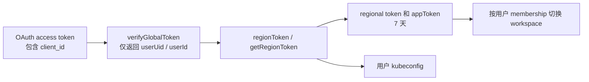

# Sealos OAuth 对外开放评估

调研日期：2026-11-03。代码基线：`beaf58c59` 加当前工作区状态；本次只新增评估文档，不修改认证实现。本文评估 Sealos 作为授权服务器向第三方发放凭证，不是 Sealos 使用 GitHub / Google 登录的上游 OAuth 集成。

## 结论

现有代码可以作为开放平台的基础，但目前不宜直接开放自助注册。授权码 + PKCE 的安全状态管理已经明显优于旧设备流；主要缺口是第三方授权的权限、资源与撤销边界，以及开发者应用管理。

建议采用 Railway 的产品方向：统一的 Sealos App 注册与用户授权，支持 OAuth 2.0 授权码 + PKCE、必要的设备流，以及用于“使用 Sealos 登录”的 OIDC。资源访问按应用获准权限、用户选择的资源、用户当前角色共同限制。协议入口可以不同，但应共享授权记录、凭证生命周期和资源鉴权策略。

最先要解决的是账号凭证向区域凭证 / kubeconfig 的交换链路。只增加 scope 字段或应用注册页，不能形成第三方权限隔离。

## 1. 当前实现

| 能力           | 已有实现                                                                                          | 对外开放判断                                                            |
| -------------- | ------------------------------------------------------------------------------------------------- | ----------------------------------------------------------------------- |
| 客户端登记     | `OAuthClient` 有 PUBLIC / CONFIDENTIAL、owner user、grant 列表、redirect URI、名称和图标          | 有基础数据模型；未见开发者注册管理 API / UI、组织所有权、状态和审核策略 |
| 授权码         | 仅 PUBLIC，强制 S256 PKCE、state、回调白名单；浏览器 cookie 绑定请求；10 分钟请求、5 分钟 code    | 可以保留；需要补 Web confidential client 接入                           |
| code 并发安全  | Serializable 事务与条件更新消费请求 / code                                                        | 已有正确方向；本次未重新执行真实数据库集成验证                          |
| code refresh   | opaque `sc_rt_`，只存哈希；每次轮换；旧值重放撤销会话族；30 天滑动到期                            | 适合作为新第三方会话机制的基础                                          |
| code revoke    | 撤销单个 refresh 会话族，未知 token 返回成功                                                      | 不是用户撤销整个应用；不影响已派生的区域凭证 / kubeconfig               |
| 设备流         | RFC 8628 形式的 device / user code、verification URI、轮询错误；device code 哈希落库，10 分钟有效 | 功能可用，但安全机制与 code flow 不一致                                 |
| 设备流 refresh | 30 天 JWT，刷新返回新的 JWT，没有消费旧值或保存会话族                                             | 不具备真正的一次性轮换与重放检测                                        |
| scope          | code flow 拒绝非空 scope；device 请求 schema 接收 scope，但 service 未保存 / 使用                 | 没有端到端的权限委托                                                    |
| 资源选择       | workspace 列表接口存在；consent 没有保存用户选择的 workspace / region                             | 列表接口不等于资源授权白名单                                            |
| OIDC           | 未见服务端 Discovery / JWKS / ID token / UserInfo 实现                                            | 目前不能宣传标准 OIDC 登录                                              |

主要证据：

- [OAuthClient 与旧 consent 模型](/Users/jingyang/work/sealos/frontend/desktop/prisma/global/schema.prisma:39)：`OAuthUserConsent` 只记录 user-client 关系，没有 scopes、资源白名单或撤销状态；新 refresh session 也没有 grant 资源模型。
- [授权码服务](/Users/jingyang/work/sealos/frontend/desktop/src/services/backend/oauth2/authorization-code.ts:138)：PUBLIC 限制、scope 拒绝、一次性兑换与 refresh 会话族。
- [浏览器授权边界](/Users/jingyang/work/sealos/frontend/desktop/src/services/backend/oauth2/code-http.ts:59)：登录凭证、请求 cookie、同源 JSON 决策。
- [设备流服务](/Users/jingyang/work/sealos/frontend/desktop/src/services/backend/oauth2/service.ts:77)：设备授权、换 token、JWT 刷新、同意 / 拒绝。
- [现有实现说明](/Users/jingyang/work/sealos/frontend/desktop/docs/oauth-authorization-code.md:1) 已明确将 scopes、OIDC、资源选择和开发者管理列为延期项。这是原生客户端阶段的既有边界，不宜直接视作第三方平台契约。

## 2. 开放前的关键问题

### P0：第三方授权会退化为账号级访问

当前调用链为：



`verifyGlobalToken` 验证 OAuth JWT 后将其转换为用户身份，丢失 `client_id`、scope 和潜在 grant 信息。`regionToken` 接口随后仅以 userUid / userId 换取区域凭证与 kubeconfig。区域 / 应用 token 有效期为 7 天，后续 namespace switch 按用户 membership 检查，没有应用授权资源检查。

证据：[身份信息转换](/Users/jingyang/work/sealos/frontend/desktop/src/services/backend/auth.ts:102)、[区域交换入口](/Users/jingyang/work/sealos/frontend/desktop/src/pages/api/auth/regionToken.ts:8)、[返回三种凭证](/Users/jingyang/work/sealos/frontend/desktop/src/services/backend/regionAuth.ts:333)、[7 天签发](/Users/jingyang/work/sealos/frontend/desktop/src/services/backend/auth.ts:168)、[空间切换](/Users/jingyang/work/sealos/frontend/desktop/src/pages/api/auth/namespace/switch.ts:14)、[全局凭证直接导出 kubeconfig](/Users/jingyang/work/sealos/frontend/desktop/src/pages/api/auth/getDefaultKubeconfig.ts:14)。

这是代码静态追踪结论，没有用真实用户或生产集群演示。实际 Kubernetes 权限和 kubeconfig 寿命由集群决定；这里不声称取得集群管理员权限。

影响：以后即使签发 `metrics:read`，只要该 token 仍能走这些旧入口，就可能获得不保留应用限制的凭证。撤销 refresh 或等待 OAuth access token 的 1 小时到期，也不能使已经换出的 7 天区域凭证、appToken 或 kubeconfig 自动失效。

**建议：新第三方 token 与第一方登录凭证明确区分；所有旧凭证交换和导出入口拒绝第三方 token。第三方经统一资源 API 执行操作，服务端保留并检查应用、grant、scope、region 和 workspace。** 不能只在 SDK 中隐藏旧入口，API 服务端必须拒绝。

### P0：设备流的一次性兑换与 refresh 生命周期不足

- device_code 换 token 先读状态、签发，再按 `id` 更新为 CONSUMED，未以条件更新和事务保证只消费一次。并发请求可能都读取 APPROVED；这是代码层面的竞态风险，本次没有进行并发数据库复现。
- approve / deny 在事务外读取 PENDING，更新时没有保留 PENDING 条件；授权决策也应原子化。
- refresh 验证 JWT 后直接重新签发，旧值在其有效期内仍可使用；没有会话级撤销与重放检测。刷新权限检查使用 device grant，而不是显式的 refresh grant 策略。

证据：[消费状态更新](/Users/jingyang/work/sealos/frontend/desktop/src/services/backend/oauth2/service.ts:136)、[JWT refresh](/Users/jingyang/work/sealos/frontend/desktop/src/services/backend/oauth2/service.ts:222)、[授权决策](/Users/jingyang/work/sealos/frontend/desktop/src/services/backend/oauth2/service.ts:333)。现有测试还将“旧 refresh 重放”和“并发 device_code 兑换”明确列为 TODO：[测试](/Users/jingyang/work/sealos/frontend/desktop/src/__tests__/unit/backend/oauth2-idp/service.test.ts:362)。

新第三方 device clients 应使用与 code flow 共享的 opaque refresh / session family 和撤销机制。旧第一方 JWT 的兼容迁移可单独按 client / 协议版本处理；新机制失败不能回退为旧的宽权限认证。

### P0：没有 scope 的兼容放行不能沿用到第三方

workspace 接口仅在 `claims.scope` 非空时检查，未携带 scope 时兼容放行；当前两种授权又都不真正签发资源 scopes。

证据：[workspace scope 判断](/Users/jingyang/work/sealos/frontend/desktop/src/pages/api/auth/oauth2/workspaces.ts:54)、[device scope 输入](/Users/jingyang/work/sealos/frontend/desktop/src/schema/oauth2.ts:47)、[code scope 拒绝](/Users/jingyang/work/sealos/frontend/desktop/src/services/backend/oauth2/authorization-code.ts:153)。

第三方 token 缺少必需 scope / grant 应拒绝；未知 scope 应返回 `invalid_scope`。第一方兼容策略只能依据服务端可信的客户端登记实施，不能让请求参数决定是否豁免。列表、详情、写操作都必须应用相同资源过滤。

### P1：设备流的限流、验证码与防钓鱼

user_code 当前使用 `Math.random()`，应改为密码学安全随机数。device 创建、user_code 查询和旧 token 分支在模块内未见与 code flow 同类的限流；网关是否另有限流本次未验证。建议按 IP、client、grant 和验证码尝试次数组合限制，清理到期 grant，并处理极低概率的唯一值碰撞。

当前轮询只按固定 5 秒判断过快。RFC 8628 要求客户端收到 `slow_down` 后，本次及后续等待间隔累计增加 5 秒；应提供遵循这一契约的 SDK，并按需要保存服务端退避状态。不能把固定 5 秒检查当成完整的滥用防护。授权确认页应显示账号、应用开发者、权限、所选资源及匹配验证码，提醒用户只批准自己刚发起的设备请求。[RFC 8628 §3.3.1、§3.5、§5](https://www.rfc-editor.org/rfc/rfc8628.html)

当前确认页只有应用信息和账号访问提示，没有验证码对比及资源选择：[device 页面](/Users/jingyang/work/sealos/frontend/desktop/src/pages/oauth2/device.tsx:37)、[consent 页面](/Users/jingyang/work/sealos/frontend/desktop/src/pages/oauth2/consent.tsx:111)。设备决策目前要求显式登录 header，不能仅凭没有 Origin 检查断言存在 CSRF；仍建议统一浏览器决策的同源和请求绑定策略。

## 3. Railway 方案及可借鉴的部分

Railway 公开文档、在线 metadata、官方 CLI 源码的具体核对见 [Railway / GitHub 研究笔记](/Users/jingyang/work/sealos/frontend/desktop/docs/railway-oauth-research.md)。下表只概括与 Sealos 决策直接相关的内容。

| 方面             | Railway 的公开方案                                                                       | Sealos 建议                                                                   |
| ---------------- | ---------------------------------------------------------------------------------------- | ----------------------------------------------------------------------------- |
| App 管理         | workspace Developer 设置，由管理员创建管理；Web confidential 和 Native public 分开       | 开发者账户 / 团队持有 App，明确 owner、状态、回调、权限与凭证管理             |
| 授权协议         | OAuth 2.0 + OIDC，code；Native 必须 PKCE，Web 推荐 PKCE                                  | 保留 code flow，新增 confidential；新客户端统一要求 S256 是可采用的更严格策略 |
| 权限             | 身份 scopes 与 workspace / project role scopes；用户明确选资源，权限受本人角色上限限制   | 将“能做什么”和“能操作哪些资源”分开建模，并在每次 API 请求执行                 |
| 会话             | access token 1 小时；offline_access + consent 获取 refresh；refresh 会轮换               | 可复用现有 code session family；不用照搬其一年 refresh 寿命                   |
| 开发者与用户管理 | 管理 client secrets、App；用户查看和调整授权资源；断开 App 时文档承诺全部 token 立即失效 | 同时提供开发者控制台和用户已授权应用页，并设计可验证的资源 API 撤销时限       |
| 扩展             | metadata 宣告设备流，CLI 有实际实现；另有动态客户端注册和 PAR                            | 设备流作为 CLI / 无浏览器场景入口；DCR、PAR 可后置                            |

来源：[创建 App](https://docs.railway.com/integrations/oauth/creating-an-app)、[Scopes 与资源选择](https://docs.railway.com/integrations/oauth/scopes-and-user-consent)、[登录与 token](https://docs.railway.com/integrations/oauth/login-and-tokens)、[管理 App](https://docs.railway.com/integrations/oauth/managing-an-app)、[用户授权管理](https://docs.railway.com/integrations/oauth/authorized-apps)、[Discovery](https://backboard.railway.com/oauth/.well-known/openid-configuration)。

Railway 的 token 轮换文档不是“每个 refresh 请求必然返回不同值”：文档说明初期可能相同，之后会轮换，客户端应始终保存最新响应。公开文档没有证明其内部数据库事务、存储结构或框架选择，不将它们作为已知实现。其 CLI 支持 device grant 也不代表任意第三方 client 默认都获准该 grant。

GitHub 应区分 OAuth Apps 与 GitHub Apps。前者可作为授权接入与开发者体验参考；对部署平台的团队级后台集成，GitHub Apps 的 installation、资源选择、细粒度权限更有借鉴价值。当前 GitHub 文档也有 OAuth App 可选 expiring tokens，不能沿用“OAuth Apps 永远没有 refresh”的旧结论。具体事实与来源见研究笔记；首期不必完整复制 GitHub App 的安装体系。

## 4. 推荐的目标模型

### 4.1 明确两类产品能力

**使用 Sealos 登录**：第三方只获取稳定用户标识和明确同意的 profile / email。建议提供 OIDC Code Flow、Discovery、JWKS、UserInfo；不因此获取部署和 Kubernetes 权限。OIDC 的 ID token 用于确认身份，API access token 用于访问资源，两者分别验证。[OIDC Core](https://openid.net/specs/openid-connect-core-1_0.html)

**连接 Sealos 资源**：第三方请求业务权限，由用户选择 region / workspace，平台逐请求检查授权与当前成员角色。首期可只支持选中的 workspace 与少量只读 API，之后增加部署等写能力。即使暂不建设 OIDC，资源 OAuth 也必须先落实这些限制。

角色 scopes 和动作 scopes 都可以符合 OAuth；标准没有要求必须采用 Railway 的 `workspace:viewer` 命名。建议基于 Sealos 的真实 API 能力定义少量动作，例如 `workspaces:read`、`apps:read`、`metrics:read`，后续按需加 `deployments:write`。这些是候选名称，尚未实现，也不是现有 `read:workspaces` 的直接兼容承诺。region / workspace 标识保存在 grant 资源集合中，不通过无限增殖的 scope 字符串表达。

### 4.2 最小数据模型

| 对象                               | 核心字段 / 责任                                                                                                                                          |
| ---------------------------------- | -------------------------------------------------------------------------------------------------------------------------------------------------------- |
| App / OAuthClient                  | 可信的 server-generated client_id、owner、public/confidential、first-party/third-party、状态、redirects、allowed grants / scopes、官网 / 隐私政策 / logo |
| ClientSecret                       | 仅 confidential，随机生成、只显示一次、存哈希、支持轮换期间并存和单独撤销                                                                                |
| AuthorizationGrant                 | user、client、获准 scopes、明确选择的 region/workspace、状态、版本、授权 / 撤销时间                                                                      |
| AuthorizationRequest / DeviceGrant | 各自协议状态机，最终原子地绑定同一种 AuthorizationGrant                                                                                                  |
| RefreshSession / TokenFamily       | 关联 grant、会话 / 设备、token 哈希、消费记录、到期与撤销状态                                                                                            |
| AuditEvent                         | 应用创建 / 改权限 / secret 轮换、授权 / 撤销、关键资源写操作；不记录原始 code / token                                                                    |

有效权限应同时满足：应用已获准的能力、用户此次同意的 scopes、选择的资源、用户当前 RBAC 权限、组织安全策略。成员被移除或降权后，应用权限应随之收缩；不能只在首次签发时检查。

用户新增 scope 或资源，应重新授权。首期每次确认即可，自动跳过 consent 可后置。workspace 管理员创建 App 和资源管理员同意安装 App 是不同的授权动作；不要因为拥有开发者 App 就自动获得别人 workspace 的资源。

### 4.3 客户端和协议契约

| 使用场景             | 默认方案                                                                                                              |
| -------------------- | --------------------------------------------------------------------------------------------------------------------- |
| 有后端的第三方网站   | Confidential + code + S256 PKCE + 标准客户端认证；secret 留在后端                                                     |
| 桌面 / 手机应用      | Public + 系统浏览器 + code + S256 PKCE；安全回调与 OS 凭证存储                                                        |
| 本地 CLI             | 可用浏览器时 code + loopback；SSH / 远程 / 无浏览器时 RFC 8628 device flow                                            |
| 纯前端 SPA           | Public + code + PKCE；如果纳入支持范围，需要单独定义 token endpoint CORS 与浏览器凭证保存策略；有条件优先后端会话方案 |
| 无用户在场的团队集成 | 后续设计 workspace installation / service identity；不把用户设备流或 client secret 直接等同于机器访问授权             |

public client 的 client_id 是公开标识，不能证明是官方软件；安装包里的通用 secret 也不能提供可靠的客户端保密能力。[RFC 8252](https://www.rfc-editor.org/rfc/rfc8252)

协议基本要求：精确回调白名单、loopback 端口的标准例外、一次性短效 code、S256、参数重复检查、禁止 token 进入回调 URL、token 响应 no-store、TLS、标准 form-urlencoded 与 Bearer header、统一 OAuth 错误。旧业务入口当前有裸 token header 约定；新资源 API 应提供统一标准，不让开发者依赖内部换凭证细节。[RFC 6749](https://www.rfc-editor.org/rfc/rfc6749)、[RFC 6750](https://www.rfc-editor.org/rfc/rfc6750)、[RFC 7636](https://www.rfc-editor.org/rfc/rfc7636)

### 4.4 凭证与撤销策略

现有第一方 JWT 无需为了开放平台立即整体替换。新第三方资源 API 可以优先采用 opaque access token + 服务端 grant 查询，易于执行撤销和权限变化；若使用 JWT，则需验证 issuer / audience / 类型并关联 grant 状态，签名正确不能替代授权检查。OIDC ID token 需要独立的签名密钥公布与验证契约；opaque API token 不要求开发者自行解析 JWT。

建议保留新 code flow 已有的 opaque refresh 一次性轮换与 family 重放检测，统一覆盖新第三方设备流；refresh 不能扩大 scopes / 资源，后台访问应显式同意。采用短 access TTL 和明确的 refresh 闲置 / 绝对期限；具体天数是产品策略，不是 RFC 强制值。public client 的 refresh 应使用轮换重放检测或发送方绑定等 BCP 认可机制。[RFC 9700 §4.14](https://www.rfc-editor.org/rfc/rfc9700.html#section-4.14)

必须区分三种操作：撤销某次登录会话、用户断开整个 App、平台停用 App。后两者应影响相关的全部 grant / 会话，而不仅是用户当前持有的一枚 refresh token。RFC 7009 是 token 撤销契约，不自动提供“已授权应用管理”产品能力。[RFC 7009](https://www.rfc-editor.org/rfc/rfc7009)

对外公布可测试的撤销生效时间，例如新资源 API 在 60 秒内拒绝已撤销 grant；这是候选服务目标，不是当前承诺。缓存必须在该时限内失效。首期第三方不导出用户原始 kubeconfig；若以后开放 Kubernetes 访问，应另建受限、短期、可归属 App / grant 的凭证和 RBAC 机制，仅替换 namespace 字符串不等于权限收敛。

### 4.5 开发者平台最小范围

开发者可创建测试 App、配置回调和权限、区分客户端类型；confidential 可生成 / 轮换 secret；可停用应用。用户可以看到开发者身份、获准权限和资源、授权时间，并断开应用。平台需要 client 与用户配额、滥用封禁、重要配置变更审计。

建议先邀请制或测试用户白名单，资源写权限按风险审批。应用审核、域名验证、隐私政策是产品治理选择，不是 OAuth 标准的强制要求，也不应宣称 Railway 必有人工审核。OAuth metadata 建议优先提供；DCR、PAR、DPoP、完整应用市场可按明确需求迭代，不作为第一版默认范围。[RFC 8414](https://www.rfc-editor.org/rfc/rfc8414)、[RFC 9700](https://www.rfc-editor.org/rfc/rfc9700.html)

## 5. 分期交付与验收

| 阶段            | 交付内容                                                                                                              | 验收条件                                                                                                   |
| --------------- | --------------------------------------------------------------------------------------------------------------------- | ---------------------------------------------------------------------------------------------------------- |
| A：权限边界     | 第三方 token 分类、统一 grant / scope / 资源策略；关闭旧区域凭证与 kubeconfig 交换；设备状态原子化与 refresh 生命周期 | 只读 App 不能调用写 API、换普通 regional/appToken、导出 kubeconfig，不能访问未选择的 workspace             |
| B：受邀只读接入 | App 最小 CRUD、public/confidential、确认页选择资源、已授权 App 与撤销、限流审计、接入样例                             | 独立的 Web 测试 App 和 CLI 完成授权、业务 API、刷新、断开；管理员停用有效；已有第一方流程回归通过          |
| C：标准登录     | 若提供“使用 Sealos 登录”，上线 OIDC Discovery / ID token / JWKS / UserInfo、密钥轮换和标准库接入说明                  | 身份 token 正确验证 issuer / audience / nonce；profile/email 按 scope 返回，身份权限不能升级到业务资源权限 |
| D：扩大生态     | 按用例开放部署写权限、组织安装 / 服务身份，再考虑自助发布、DCR / PAR 等                                               | 权限升级重新同意、组织成员变更与撤销传播均验证；资源操作可以审计到具体 App                                 |

若首批需求只是身份登录，C 可提前并省去资源 API 的初期业务范围，但必须先隔离旧凭证链路；若首批是 CLI / 部署集成，则 A+B 优先，OIDC 可独立安排。这里不给未经拆解验证的工期估计。

最低测试契约：

1. 数据库并发下 code / device_code 至多成功兑换一次；approve 与 deny 竞态只有一个最终结果。
2. refresh 正常轮换、旧值重放、并发刷新、单会话与整 App 撤销；验证真实 API 拒绝访问，不能只断言数据库字段。
3. 不带 scope、未知 scope、读 token 调写接口、访问未选资源、伪造 workspace 参数均被拒绝。
4. 所有旧 global-to-regional、appToken、kubeconfig 导出与空间切换入口都无法绕过第三方限制。
5. 资源列表只列授权范围；用户降权、退出 workspace、App 停用后按公布时限生效。
6. confidential 错 secret / 错认证方式、public 无 secret、坏回调、重复参数、PKCE 不匹配等按标准失败。
7. device pending / deny / expiry / slow_down、验证码确认、限流、到期清理；第一方旧客户端兼容回归。

## 6. 本次验证范围

已用 CodeGraph 辅助追踪调用关系，并按当前源文件确认关键链路。执行：

```fish
pnpm --dir desktop exec vitest run src/__tests__/unit/backend/oauth2-idp --project unit
```

结果：7 个测试文件通过，54 passed、2 TODO。两项 TODO 正是旧 refresh 重放和 device_code 并发兑换保护。测试包含有意注入数据库异常的错误响应场景，预期 stderr 不表示套件失败。

本次未运行授权码真实数据库集成、浏览器烟测或生产部署检查；现有 integration 文件需要独立 `OAUTH_TEST_DATABASE_URL`。没有检查集群 RBAC 全貌或网关限流，因此不将静态风险描述为生产漏洞已复现，也不以现有单测通过作为第三方开放验收。

外部资料优先使用 Context7 的 Railway 官方文档索引，再核对官方网页、live metadata、官方 CLI 源码与 RFC / OIDC 原文。外部结论及不能确认项详见 [研究笔记](/Users/jingyang/work/sealos/frontend/desktop/docs/railway-oauth-research.md)。
